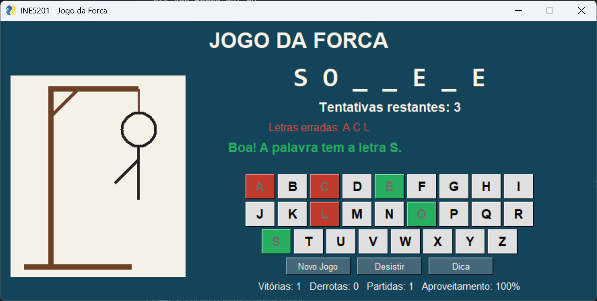
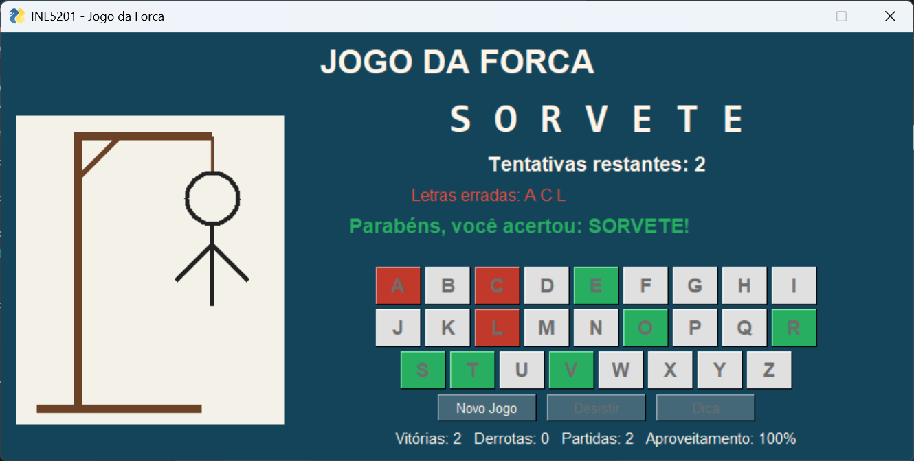
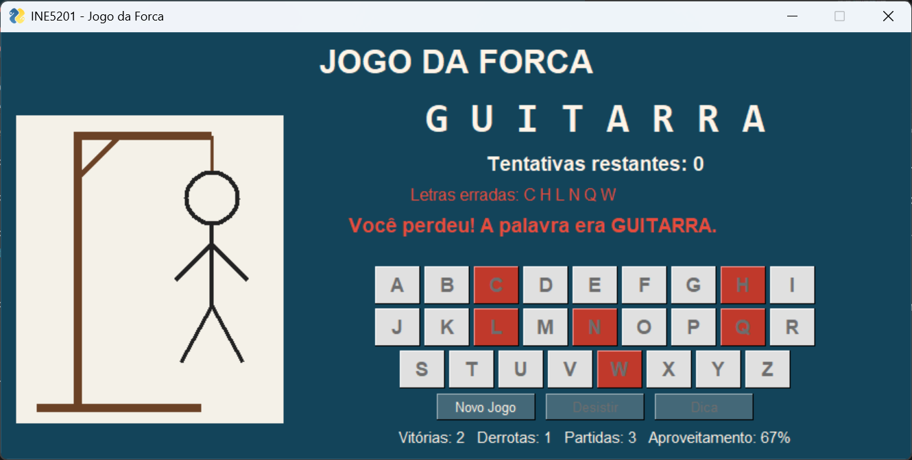

# Jogo da Forca

Tarefa 03 da disciplina **INE5201 - Introdução à Ciência da Computação com Python** (UFSC).

Jogo da Forca com interface gráfica em FreeSimpleGUI. As palavras são lidas do arquivo `palavras.txt` e sorteadas a cada partida, o boneco é desenhado parte por parte a cada erro e as estatísticas de vitórias e derrotas ficam salvas entre uma execução e outra.

## Participantes

| Nome | Matrícula |
|---|---|
| Paulo Ricardo Eliel Mendes Peres dos Santos | 24100434 |
| Matheus da Silva Farani | 24202994 |

## Como executar

Requisito: Python 3.10 ou mais recente.

```bash
pip install -r requirements.txt
python forca_gui.py
```

No Windows, se `python` não for reconhecido, use `py` no lugar. O arquivo `palavras.txt` precisa estar na mesma pasta do `forca_gui.py`.

## Como jogar

Uma palavra é sorteada e aparece com as letras ocultas (`_ _ _ _`). Clique nas letras do teclado virtual ou digite no teclado do computador. Cada letra certa aparece na palavra e fica verde. Cada letra errada fica vermelha e desenha uma parte do boneco. Vence quem descobrir a palavra antes de 6 erros.

| Botão | O que faz |
|---|---|
| **Novo Jogo** | Sorteia outra palavra. Se a partida atual já começou, ela conta como derrota (o jogo pergunta antes). |
| **Desistir** | Encerra a partida como derrota e revela a palavra. |
| **Dica** | Revela uma letra oculta ao custo de 1 tentativa. Pode ser usada uma vez por partida e só quando resta mais de uma tentativa. |

## Funcionalidades

**Interface**
- Palavra com letras ocultas no formato `P _ T H _ N`
- Teclado virtual de A a Z; as letras já usadas ficam desabilitadas, em verde (acerto) ou vermelho (erro)
- Forca e boneco desenhados em um `sg.Graph`, com 6 partes: cabeça, tronco, 2 braços e 2 pernas
- Contador de tentativas restantes e lista das letras erradas
- Mensagens de acerto, erro, vitória e derrota na janela e em popup
- Botões **Novo Jogo**, **Desistir** e **Dica**
- Placar com vitórias, derrotas, total de partidas e aproveitamento

**Regras e validações**
- Máximo de 6 erros
- Letra repetida não conta como erro: aparece o aviso "A letra X já foi tentada"
- O teclado do computador também funciona; letras acentuadas digitadas (como ç ou á) viram a letra sem acento
- Ao perder ou desistir, a palavra inteira é revelada
- A nova palavra nunca é igual à da partida anterior
- Depois do fim da partida, o teclado fica bloqueado até clicar em **Novo Jogo**

**Arquivos e strings**
- `palavras.txt` com 64 palavras, uma por linha
- Na leitura, cada linha passa por `strip()`, tem os acentos removidos e vai para maiúsculas: `coração` vira `CORACAO`
- Linhas vazias, comentários (`#`), palavras repetidas e linhas com números ou símbolos são ignoradas
- Se o arquivo não existir ou tiver menos de 50 palavras válidas, o jogo mostra uma mensagem de erro em vez de travar
- As estatísticas ficam em `estatisticas.txt`, no formato `vitorias=3`; se o arquivo estiver corrompido, a contagem recomeça do zero

## Estrutura do código

```
forca_gui.py
├── Constantes: caminhos dos arquivos, limites, alfabeto e cores
├── Arquivos
│   ├── normalizar(texto)
│   ├── carregar_palavras(arquivo)
│   ├── escolher_palavra(lista, anterior)
│   ├── carregar_estatisticas()
│   └── salvar_estatisticas(vitorias, derrotas)
├── Lógica do jogo
│   ├── atualizar_display(palavra, letras_tentadas)
│   ├── verificar_vitoria(palavra, letras_tentadas)
│   ├── letras_erradas(palavra, letras_tentadas)
│   ├── contar_erros(estado)
│   ├── tentar_letra(estado, letra)
│   ├── revelar_dica(estado)
│   └── novo_estado(palavras, anterior)
├── Interface gráfica
│   ├── desenhar_boneco(grafico, erros)
│   ├── criar_layout()
│   ├── atualizar_tela(window, estado, mensagem, cor)
│   ├── encerrar_partida(window, estado, estatisticas, venceu, mensagem)
│   ├── processar_letra(window, estado, estatisticas, letra)
│   └── letra_do_evento(event)
└── main(): carrega os arquivos e roda o loop de eventos
palavras.txt: 64 palavras, uma por linha
```

**Estado da partida.** Tudo que muda durante uma partida fica em um dicionário: a palavra sorteada, o conjunto (`set`) de letras tentadas e quantas dicas foram usadas. Com um `set`, verificar se uma letra já foi tentada é só `letra in tentadas`, e a vitória é `set(palavra) <= tentadas`, ou seja, todas as letras da palavra já foram tentadas.

**Erros contados a partir das letras.** O número de erros não é guardado em uma variável separada: ele é calculado como a quantidade de letras tentadas que não estão na palavra, mais as dicas usadas. Assim o contador e o desenho nunca ficam fora de sincronia.

**Remoção de acentos.** `normalizar` usa `unicodedata.normalize('NFD', ...)`, que separa cada letra do seu acento (`ã` vira `a` + `~`), e depois descarta os acentos. Por isso o arquivo pode ter palavras acentuadas e o jogador só precisa das letras de A a Z.

**Caminho dos arquivos.** Os arquivos são localizados a partir da pasta do próprio `forca_gui.py` (`os.path.dirname(__file__)`), então o jogo funciona mesmo se for executado de outra pasta.

## Screenshots

**Partida em andamento**



**Vitória**



**Derrota com o boneco completo**



## Uso do GitHub Copilot

Usei o chat do GitHub Copilot no VS Code, no modo **Ask** (só perguntas, sem deixar ele alterar os arquivos). Não pedi para ele criar o jogo; selecionei funções prontas e pedi explicações ou melhorias.

| Prompt | Função assistida | O que aproveitei ou mudei |
|---|---|---|
| "Explique passo a passo como esta função remove os acentos de uma palavra" | `normalizar` | Usei a explicação para entender o caminho `strip` → `NFD` (separa letra e acento) → descarta a categoria `Mn` → `upper`. Não alterei o código. |
| "Sugira melhorias para esta função que lê as palavras do arquivo" | `carregar_palavras` | Aceitei usar um `set` (`vistas`) para detectar palavras repetidas. Descartei trocar a validação por `isalpha()`, porque ela aceita letras fora de A-Z que o teclado virtual não tem, e descartei devolver a lista ordenada, porque a palavra é sorteada. |
| "Como posso deixar o desenho deste boneco mais bonito no FreeSimpleGUI?" | `desenhar_boneco` | Descartei a sugestão. O código proposto desenhava as partes com `partes[:erros - 1]`, então com 6 erros o boneco ficaria com 5 partes, e o desenho e o contador ficariam fora de sincronia. Mantive `partes[:erros]`. |

**Relato.** O Copilot ajudou em três funções: `normalizar`, `carregar_palavras` e `desenhar_boneco`. Em `normalizar`, a explicação passo a passo me ajudou a entender como o `unicodedata` separa a letra do acento antes de descartá-lo. Aceitei a sugestão de usar um `set` em `carregar_palavras` para verificar palavras repetidas, porque procurar em um conjunto é mais rápido do que percorrer a lista, e a ordem das palavras continua na lista. Descartei a troca por `isalpha()`, que aceitaria letras como `ß` ou `Ø` (que não têm acento para remover) e que não existem no teclado do jogo, e corrigi a sugestão do desenho do boneco, que usava `erros - 1` e deixaria o boneco incompleto na derrota. Aprendi que é preciso testar o que o Copilot sugere, porque uma mudança "estética" pode quebrar uma regra do jogo.

## Tecnologias

- Python 3
- [FreeSimpleGUI](https://pypi.org/project/FreeSimpleGUI/)
- Bibliotecas padrão: `random`, `os` e `unicodedata`
- GitHub Copilot
